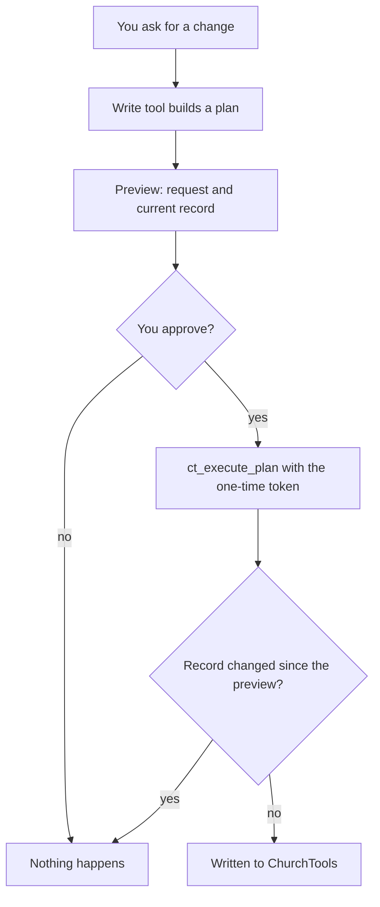

<div align="center">

# churchtools-mcp

**Talk to your ChurchTools instance from Claude, and approve every change before it happens.**

[](https://github.com/NoahDR/churchtools-mcp/actions/workflows/ci.yml)
[](LICENSE)


</div>

An [MCP](https://modelcontextprotocol.io) server for [ChurchTools](https://church.tools). Plug it into Claude
Code or any other MCP client and ask in plain words:

> _Who is on the tech team for Sunday's service, and who is still missing?_
>
> _Put Lena into the youth leaders group._
>
> _Move the prayer evening on 12 November to 8 pm._

Reads happen right away. Writes come back as a preview first: what would change, next to the record as it
is now. Nothing is written until you say yes.

> [!NOTE]
> A community project, not made, endorsed or supported by ChurchTools Innovations GmbH.

## What it can do

- **Persons**: search, read, create, update, delete. The preview of a create lists persons with the same name.
- **Groups**: manage groups and their members, roles included.
- **Calendars**: list, create, update and delete appointments. Creating one from an event template creates
  the event too.
- **Events**: read events and services, and staff them with people from ChurchTools or by name.
- **Agendas & songs**: read and plan agenda items, lock state, songs and arrangements.
- **Services (modern)**: service groups, possible persons, service and exchange requests.
- **Absences, resources & bookings**: read and plan them; a booking plan shows its conflicts first.
- **Facts, follow-ups, wiki, tags, notes & relationships**: read directly, changed only as a plan.
- **Master data, group meetings, appointment templates, meeting requests, posts, permissions**:
  read-only bundles.
- **Everything else**: the server reads your instance's own OpenAPI spec, so Claude can find and call any of
  the 800+ endpoints. Finance has no curated tool on purpose (see below).

## Quick start

You need Node 26 and a ChurchTools account (with 2FA, ideally).

```bash
git clone https://github.com/NoahDR/churchtools-mcp.git
cd churchtools-mcp
npm ci && npm run build
cp .env.example .env
```

Fill in `.env`, keeping the double quotes: a `#` in an unquoted value starts a comment.

```bash
CT_URL="https://your-church.church.tools"
CT_USERNAME="you@example.org"
CT_PASSWORD="..."
```

Then register the server:

| Client                       | How                                                                                           |
| ---------------------------- | --------------------------------------------------------------------------------------------- |
| Claude Code, this repository | start `claude` in the repository and approve `churchtools` from `.mcp.json` once              |
| Claude Code, everywhere      | `claude mcp add --scope user churchtools -- node --env-file=<repo>/.env <repo>/dist/index.js` |
| Any other MCP client         | run `node --env-file=<repo>/.env <repo>/dist/index.js` over stdio                             |

Ask Claude to log in. With 2FA on, it asks for the current code from your authenticator app. A session
lasts about a day.

## How a write works



A plan token works once and expires after 10 minutes. A generic write to a path without a GET endpoint
skips the "changed since" check, because there is nothing to compare.

## Security

- **Your rights, no more.** The server acts as the logged-in user. Give that account only the rights you
  need.
- **Secrets stay local.** The password goes only to `CT_URL` over https, and the server follows no
  redirects. The session lives in memory. On disk there is only the cached API spec in
  `~/.cache/churchtools-mcp`.
- **Data protection.** Member data you ask about goes to your MCP client's model provider. Check that this
  fits your church's rules before you use real data.
- **Prompt injection.** Text inside ChurchTools records reaches the model and could try to steer it. That is
  why every write needs your approval: read the preview.

Found a vulnerability? Please report it privately: [SECURITY.md](SECURITY.md).

<details>
<summary><b>All tools</b></summary>

| Group                          | Tools                                                                                                                                                                                                                                                                                                                                                                                                                                                          |
| ------------------------------ | -------------------------------------------------------------------------------------------------------------------------------------------------------------------------------------------------------------------------------------------------------------------------------------------------------------------------------------------------------------------------------------------------------------------------------------------------------------- |
| Session                        | `ct_status`, `ct_login`                                                                                                                                                                                                                                                                                                                                                                                                                                        |
| Plans                          | `ct_execute_plan`                                                                                                                                                                                                                                                                                                                                                                                                                                              |
| Any endpoint                   | `ct_search_api`, `ct_get_operation`, `ct_api_request`                                                                                                                                                                                                                                                                                                                                                                                                          |
| Persons                        | `ct_search_persons`, `ct_get_person`, `ct_create_person`, `ct_update_person`, `ct_delete_person`                                                                                                                                                                                                                                                                                                                                                               |
| Groups                         | `ct_search_groups`, `ct_get_group`, `ct_create_group`, `ct_update_group`, `ct_delete_group`, `ct_list_group_members`, `ct_add_group_member`, `ct_update_group_member`, `ct_remove_group_member`                                                                                                                                                                                                                                                                |
| Calendars                      | `ct_list_calendars`, `ct_list_appointments`, `ct_get_appointment`, `ct_create_appointment`, `ct_update_appointment`, `ct_delete_appointment`, `ct_list_appointment_templates`, `ct_get_appointment_template`, `ct_list_meeting_requests`, `ct_list_open_meeting_requests`, `ct_answer_meeting_request` (plan)                                                                                                                                                  |
| Events                         | `ct_list_events`, `ct_get_event`, `ct_list_services`, `ct_update_event`, `ct_delete_event`, `ct_assign_event_service`, `ct_set_external_event_service`                                                                                                                                                                                                                                                                                                         |
| Agenda                         | `ct_get_event_agenda`, `ct_list_event_agenda_songs`, `ct_list_agenda_templates`, `ct_get_agenda_template`, `ct_create_agenda_item`, `ct_update_agenda_item`, `ct_delete_agenda_item`, `ct_hide_agenda_item`, `ct_unhide_agenda_item`, `ct_lock_agenda`, `ct_unlock_agenda` (writes as plans)                                                                                                                                                                   |
| Songs                          | `ct_search_songs`, `ct_get_song`, `ct_list_song_arrangements`, `ct_get_song_arrangement`, `ct_list_song_categories`, `ct_list_song_sources`, `ct_create_song`, `ct_update_song`, `ct_delete_song`, `ct_create_song_arrangement`, `ct_update_song_arrangement`, `ct_delete_song_arrangement`, `ct_set_default_arrangement` (writes as plans)                                                                                                                    |
| Services (modern)              | `ct_list_service_groups`, `ct_get_service_group`, `ct_get_service`, `ct_list_possible_persons`, `ct_list_person_service_requests`, `ct_get_person_service_request`, `ct_list_exchange_requests`, `ct_list_exchange_candidates`, `ct_accept_service_request`, `ct_decline_service_request`, `ct_undo_service_request`, `ct_update_service_request`, `ct_create_exchange_request`, `ct_accept_exchange_request`, `ct_decline_exchange_request` (writes as plans) |
| Absences                       | `ct_list_person_absences`, `ct_get_person_absence`, `ct_list_group_absences`, `ct_create_absence`, `ct_update_absence`, `ct_delete_absence` (writes as plans)                                                                                                                                                                                                                                                                                                  |
| Resources & bookings           | `ct_get_resource_masterdata`, `ct_list_bookings`, `ct_get_booking`, `ct_check_booking_conflicts`, `ct_create_booking`, `ct_update_booking`, `ct_delete_booking`, `ct_answer_booking` (writes as plans, with conflict preview)                                                                                                                                                                                                                                  |
| Master data (read)             | `ct_get_person_masterdata`, `ct_get_event_masterdata`, `ct_list_departments`, `ct_list_statuses`, `ct_list_campuses`, `ct_list_group_roles`                                                                                                                                                                                                                                                                                                                    |
| Event facts                    | `ct_list_facts`, `ct_get_fact`, `ct_list_event_facts`, `ct_get_event_fact`, `ct_set_event_fact`, `ct_create_fact`, `ct_update_fact`, `ct_delete_fact`, `ct_delete_event_fact` (writes as plans)                                                                                                                                                                                                                                                                |
| Meetings & follow-ups          | `ct_list_group_meetings`, `ct_get_group_meeting`, `ct_list_group_meeting_members`, `ct_list_followups`, `ct_get_followup`, `ct_list_group_followups`, `ct_list_person_followups`, `ct_complete_followup`, `ct_dismiss_followup`, `ct_postpone_followup` (actions as plans)                                                                                                                                                                                     |
| Wiki                           | `ct_list_wiki_categories`, `ct_list_wiki_pages`, `ct_get_wiki_page`, `ct_search_wiki`, `ct_list_wiki_page_versions`, `ct_create_wiki_category`, `ct_update_wiki_category`, `ct_delete_wiki_category`, `ct_create_wiki_page`, `ct_update_wiki_page`, `ct_delete_wiki_page` (writes as plans)                                                                                                                                                                    |
| Tags, notes, relationships     | `ct_list_tags`, `ct_list_object_tags`, `ct_list_notes`, `ct_list_relationships`, `ct_list_relationship_types`, `ct_create_tag`, `ct_add_tag`, `ct_remove_tag`, `ct_delete_tag`, `ct_add_note`, `ct_update_note`, `ct_delete_note`, `ct_create_relationship`, `ct_delete_relationship` (writes as plans)                                                                                                                                                        |
| Public, check-in, files (read) | `ct_list_group_homepages`, `ct_get_group_homepage`, `ct_get_public_group`, `ct_get_public_group_form`, `ct_list_printers`, `ct_get_qrcode_checkin`, `ct_list_files`, `ct_get_file_metadata`                                                                                                                                                                                                                                                                    |
| Posts & permissions (read)     | `ct_list_posts`, `ct_get_post`, `ct_list_post_comments`, `ct_search_posts`, `ct_list_person_posts`, `ct_list_permission_definitions`, `ct_get_my_permissions`, `ct_list_object_permissions`, `ct_get_permission_origins`, `ct_get_internal_permission_origins`, `ct_list_security_levels`                                                                                                                                                                      |

</details>

<details>
<summary><b>Not included (yet)</b></summary>

- HTTP transport, several instances, an npm package: it runs locally over stdio against one instance.
- Bulk writes and an audit log: one record per write, and ChurchTools keeps its own history.
- OAuth and long-lived login tokens: the login is password plus 2FA code, per session.
- A tool that creates only an event: `ct_create_appointment` does it through an event template
  ([docs/churchtools-api.md](docs/churchtools-api.md)).
- Splitting appointment series, editing a single occurrence, event service counts, 2FA enrolment,
  anonymising personal data.
- **Finance and donations**: no tool at all, deliberately — money data stays out of this server.
- **Logins and credentials of other persons**: no login-token, one-time-login, password, 2FA, privacy-consent
  or person-merge tools; `ct_login` is the only login.
- **Check-in writes**: no person is created or checked in by a tool (data protection, especially for
  children); check-in data is read-only here. Public-group signup, confirmation and token operations are
  likewise read-only (form and public info only).
- **Sending anything**: no agenda/event mail, no post sending, no bulk letters or newsletters.
- **Admin writes**: permissions, config, sync and SSO are read-only (definitions and origins only).
- **Files**: metadata only — no binary upload, because it does not fit the JSON plan flow cleanly.
- **CCLI** (not in the REST spec), "hidden" operations and the legacy API (`api.church.tools`) are not used.
- **Creating an event directly**: the spec has no `POST /events`; `ct_create_appointment` creates events
  from a template, as before.

</details>

## Contributing

Issues and pull requests are welcome: start with [CONTRIBUTING.md](CONTRIBUTING.md). `npm run check`
(types, lint, format, build, 1,000+ tests) must pass, and CI runs it on every pull request. Please follow
the [Code of Conduct](CODE_OF_CONDUCT.md).

## Uninstall

Remove `churchtools` from your MCP client, then delete `.env` and `~/.cache/churchtools-mcp`. In ChurchTools
nothing stays behind besides the ended session.

## License

[MIT](LICENSE) © Noah Reinbold
